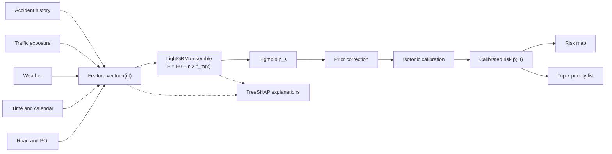

# Urban Accident Risk Prediction System — Project Documentation

**Machine Learning Team Project**

| Name | Student ID |
|------|-----------|
| Fatih Alkan | 79731 |
| Denzel Blessing Sibanda | 79826 |
| Solomon Mbedzi | 79788 |
| Helin Agze Gulec | 79879 |
| Furkan Çokpınar | 79791 |

This document collects the complete content of the project in one place: the problem, the Gap
Analysis, the Proposed Solution, the methodology, the equations, the evaluation plan and the
repository. The formal version with full citations is the LaTeX paper (ACM conference format) in [`paper/`](paper/) (also on
[Overleaf](https://www.overleaf.com/project/6b060c04e2ca21afb91b3d88/share#e13afaa6995383fe55032fde3958ebc94222bf5a139b3d31));
the presentation is in [`presentations/proposed-solution/`](presentations/proposed-solution/).

> **Status:** proposal stage. The approach is designed and documented, and the first parts of
> the code are implemented and tested. **No experimental results exist yet.** All improvements
> below are expected, not demonstrated.

## Contents

1. [Problem](#1-problem)
2. [Gap Analysis](#2-gap-analysis)
3. [Overview of the proposed solution](#3-overview-of-the-proposed-solution)
4. [Mapping research gaps to solutions](#4-mapping-research-gaps-to-solutions)
5. [System architecture](#5-system-architecture)
6. [Machine learning methodology](#6-machine-learning-methodology)
7. [Evaluation strategy](#7-evaluation-strategy)
8. [Tools and technologies](#8-tools-and-technologies)
9. [Mathematical formulations](#9-mathematical-formulations)
10. [Expected contributions and limitations](#10-expected-contributions-and-limitations)
11. [Implementation plan](#11-implementation-plan)
12. [Repository guide](#12-repository-guide)
13. [Key references](#13-key-references)

---

## 1. Problem

Police in Greater London record more than 22,000 injury road collisions per year (22,900 in
2023 according to Transport for London). Road safety resources are limited, so it is useful to
know **where** and **when** collisions are most likely.

**Prediction task.** For a given urban cell and a given three-hour window, estimate the
probability that at least one police-reported injury collision will occur, using only
information available before the window starts. The output is a calibrated risk score for every
cell and window, which can be ranked into risk maps and priority lists.

---

## 2. Gap Analysis

Accident prediction research follows two lines: statistical crash-frequency models (Poisson,
negative binomial) that are interpretable but aggregated over long periods, and machine/deep
learning models that predict risk on a spatial grid at hourly or finer resolution.

| Study | Data and region | Method | Limitation relevant to this project |
|-------|-----------------|--------|-------------------------------------|
| Lord & Mannering (2010); Mannering & Bhat (2014) | Reviews of crash-frequency studies | Poisson, negative binomial and extensions | Long aggregation periods; fixed functional forms; not for short-term prediction |
| Chen et al. (2016) | Japan; GPS mobility data and accident records | Stacked denoising autoencoder | Proprietary mobility data; no explanations |
| Yuan et al. (2018) | Iowa, USA; heterogeneous spatio-temporal data | Hetero-ConvLSTM | Limited interpretability; coarse resolution for urban use |
| Ren et al. (2018) | Beijing; accident records | LSTM on a citywide grid | Accident history only; no weather or road design |
| Moosavi et al. (2019) | Six US cities (US-Accidents) | Deep Accident Prediction (DAP) | 5 km × 5 km regions; labels from traffic-event feeds |
| Zhou et al. (2020) | New York City, Suzhou | RiskOracle (multi-task graph network) | Needs real-time traffic data; no feature-level explanations |
| Wang et al. (2021) | New York City, Chicago | GSNet with weighted loss | Black box; no calibrated probabilities |

### Identified research gaps

| ID | Gap | Description |
|----|-----|-------------|
| **G1** | Problem framing and information leakage | Many studies train only on recorded accidents, or use attributes recorded by the police *after* a collision (road surface, light conditions). These do not exist in advance and inflate performance. |
| **G2** | Limited integration of heterogeneous factors | Risk depends on exposure, weather, time and road design together, but studies use one or two sources or proprietary data. Traffic exposure is often missing. |
| **G3** | Extreme class imbalance and misleading metrics | Most cell-time units have no accident (zero inflation). Accuracy and ROC-AUC look high even for weak models. |
| **G4** | Optimistic validation | Random splits leak future and neighbouring information; robustness over time (COVID-19, data changes) is rarely tested. |
| **G5** | Lack of interpretability | The most accurate recent models are deep networks that do not explain why a location is high risk. |
| **G6** | Uncalibrated outputs and limited reproducibility | Scores are evaluated only as rankings; proprietary data and unpublished code prevent reproduction. |

---

## 3. Overview of the proposed solution

* **Study area:** Greater London (about 1,572 km²), STATS19 police forces 1 (Metropolitan Police)
  and 48 (City of London Police).
* **Spatial unit:** H3 hexagonal grid at resolution 8 (mean area about 0.74 km², about 2,200 cells).
* **Temporal unit:** three-hour windows (8 per day).
* **Period:** 2018–2024; 2025 data will be used as an additional out-of-time check.
* **Size:** about 6.4 million cell-windows per year; expected positive rate about 0.3–0.4%.
* **Model:** LightGBM with class weighting, negative subsampling with prior correction, isotonic
  calibration and TreeSHAP explanations.

**Why this approach?** The data are tabular, heterogeneous and contain missing values. On such
data tree ensembles match or beat deep networks with much less tuning (Grinsztajn et al., 2022).
LightGBM handles missing values natively, learns interactions (for example rain × darkness ×
busy road), trains on millions of rows in Google Colab and supports exact TreeSHAP explanations.

**How it differs from existing approaches:**

1. Predicts occurrence for *all* cell-windows, using only features known in advance.
2. Fuses five open data groups, including an explicit traffic-exposure estimate.
3. Uses imbalance-aware training and metrics that stay meaningful below 1% positives.
4. Validates on future years, including the 2024 change in the STATS19 specification.
5. Outputs calibrated probabilities with global and local explanations.

---

## 4. Mapping research gaps to solutions

| Gap | Proposed technique | Expected improvement | Why it is suitable |
|-----|--------------------|----------------------|--------------------|
| **G1** | Cell-window formulation with explicit non-accident samples; strict ex-ante feature policy (no police scene attributes; darkness from solar position; road surface proxied by recent rain) | True probability of occurrence; no inflated performance | Every cell-window has a label; all features exist before the window starts |
| **G2** | Fusion of STATS19 history, DfT AADF traffic counts with TRA0307 time profile, Open-Meteo weather, OpenStreetMap roads and calendar features; spatial lags | Separates busy from hazardous locations; contribution measurable by ablation | Risk depends on all factors together; trees learn interactions automatically |
| **G3** | Negative subsampling + prior correction; class-weighted cross-entropy (focal loss as alternative); PR-AUC, Recall@k, Brier score | Higher recall of rare events at useful precision; honest reporting | Prior correction restores true probabilities; PR metrics focus on the minority class |
| **G4** | Train 2018–2022, validate 2023, test 2024; expanding-window backtests; past-only history features; spatial block check; COVID-19 sensitivity run | Realistic future performance and stability evidence | Temporal and spatial blocking is recommended for dependent data |
| **G5** | TreeSHAP global importance, dependence plots and local explanations next to risk maps | Explanations that road safety staff can use | Exact Shapley values for tree ensembles in polynomial time |
| **G6** | Isotonic calibration on 2023; reliability diagrams; only open data (OGL, ODbL, CC BY 4.0) and public code | Probabilities that match observed frequencies; transferable pipeline | Non-parametric calibration for large validation sets; STATS19 covers all of Great Britain |

Each row is tested by one of the experiments E1–E8 in [Section 7](#7-evaluation-strategy).

---

## 5. System architecture

```mermaid
flowchart LR
    subgraph A["1. Data acquisition (open data)"]
        S1[STATS19 accidents]
        S2[DfT AADF + TRA0307]
        S3[Open-Meteo weather]
        S4[OpenStreetMap roads]
        S5[Calendar and sun position]
    end
    A --> B2["2. Spatio-temporal alignment<br/>H3 res. 8 × 3-h windows"]
    B2 --> B3["3. Preprocessing and cleaning"]
    B3 --> B4["4. Exploratory data analysis"]
    B4 --> B5["5. Feature engineering and selection"]
    B5 --> C6["6. Chronological split<br/>2018–22 / 2023 / 2024"]
    C6 --> C7["7. Model training<br/>B0–B4 and LightGBM"]
    C7 <-.-> D8["8. Hyperparameter optimisation<br/>Optuna TPE"]
    C7 --> C9["9. Calibration<br/>prior correction + isotonic"]
    C9 --> C10["10. Evaluation<br/>PR-AUC, Recall@k, Brier"]
    C10 --> D11["11. Prediction and explainability<br/>risk maps, top-k lists, TreeSHAP"]
```



### Prediction framework



---

## 6. Machine learning methodology

### 6.1 Data sources

| Factor group | Source | Granularity | Use |
|--------------|--------|-------------|-----|
| Historical accidents | DfT STATS19 road safety open data (OGL v3.0) | Individual collisions with coordinates, date and time | Target label; history and spatial-lag features; scene attributes only for EDA |
| Traffic conditions | DfT road traffic statistics (AADF by count point); table TRA0307 | Annual average daily flow per road link; national hour × weekday profile | Vehicle-km exposure per cell and window; HGV, motorcycle, cycle shares |
| Weather | Open-Meteo Historical Weather API (ECMWF IFS / ERA5-Land; CC BY 4.0) | Hourly, about 9–11 km grid | Precipitation, temperature, wind, snowfall, cloud cover, humidity |
| Time and calendar | `holidays` package; solar position | Per window | Cyclical encodings, weekends, bank holidays, darkness |
| Road characteristics | OpenStreetMap via OSMnx (ODbL) | Road segments, junctions, POIs | Road length by class, junctions, signals, crossings, bus stops, 20 mph share, POI counts |

**Target variable:** $y_{i,t} = 1$ if at least one collision (any severity) occurs in cell $i$
during window $t$, otherwise $0$.

### 6.2 Planned features

| Group | Features |
|-------|----------|
| Historical accidents | Counts in the previous 7, 30, 365 days; decayed intensity; same window-of-week rate; spatial lags over 1- and 2-rings |
| Traffic conditions | Vehicle-km in the window; HGV, two-wheeler and cycle shares; counted/estimated flag |
| Weather | Precipitation in the window and previous 3 h; temperature; frost; maximum wind; snowfall; cloud cover; humidity |
| Time and calendar | Window of day and month (sine/cosine); day of week; weekend; bank holiday; darkness; COVID-19 restriction flag |
| Road characteristics | Road length by OSM class; junctions with ≥3 arms; signals; crossings; bus stops; roundabouts; 20 mph share; cycle lanes; POI counts |

### 6.3 Preprocessing

| Technique | Purpose |
|-----------|---------|
| Filter by police force and London boundary | Restrict to the study area |
| Remove records without valid coordinates or time; deduplicate on `collision_index` | Place every positive in exactly one cell-window |
| Coordinate → H3 cell; time → 3-hour window | Common key $(i,t)$ for all sources |
| Nearest weather point per cell; window aggregation (sum, mean, max) | Align hourly gridded weather |
| Spatial join of AADF points and OSM features to cells | Per-cell attributes |
| Native missing-value handling (trees); median + indicator (linear, MLP) | Keep information about missingness |
| Outlier checks | Detect errors without removing real extreme events |
| One-hot encoding (linear, MLP); native categorical (LightGBM) | Suitable encoding per model |
| Z-score standardisation fitted on training data | Comparable scales for linear model and MLP |
| Negative subsampling (rate β) of the training set only | Smaller and less imbalanced training data |

**Two rules:** any fitted statistic is fitted only on training/validation years, and history
features at window $t$ use only records before $t$.

**Feature selection:** (1) leakage audit, (2) remove near-constant features, (3) correlation
filter $|\rho| > 0.95$, (4) SHAP-based pruning on the validation year; then group-level ablation.

### 6.4 Algorithms

| Model | Role | Strengths | Limitations |
|-------|------|-----------|-------------|
| B0 Historical rate | Naive baseline | Same as hotspot practice | Ignores weather, traffic, time effects |
| B1 Logistic regression (L2) | Linear baseline | Interpretable, calibrated | No interactions unless specified |
| B2 Random forest | Ensemble baseline | Robust, few hyperparameters | Memory-heavy; poorly calibrated |
| B3 MLP (PyTorch) | Neural baseline | Learns non-linear interactions | Needs tuning; weaker on tabular data |
| B4 XGBoost | Alternative GBDT | Regularised boosting | Slower than LightGBM |
| **LightGBM** | **Main model** | Fast on millions of rows; missing/categorical handling; exact TreeSHAP | Needs regularisation and early stopping |

### 6.5 Training and validation

| Run | 2018 | 2019 | 2020 | 2021 | 2022 | 2023 | 2024 |
|-----|------|------|------|------|------|------|------|
| Backtest 1 | Train | Train | Train | **Evaluate** | | | |
| Backtest 2 | Train | Train | Train | Train | **Evaluate** | | |
| **Main run** | Train | Train | Train | Train | Train | **Validate** | **Test (once)** |
| Sensitivity run | Train | Train | — | — | Train | Validate | Test |

* **Training:** 2018–2022 (COVID-19 years flagged). **Validation:** 2023 (early stopping, tuning,
  calibration, threshold). **Test:** 2024, evaluated once.
* Spatial block check with H3 resolution-6 parents; sensitivity run without 2020–2021.
* Negative subsampling with β = 0.05 gives about 1.7 million training rows; validation and test
  use the full grid, predicted in monthly chunks.

### 6.6 Hyperparameter optimisation

Optuna with the Tree-structured Parzen Estimator, 100 trials per model, median pruning, objective
= validation PR-AUC, early stopping after 100 rounds without improvement.

| Model | Search space |
|-------|--------------|
| LightGBM | `num_leaves` 15–255; `learning_rate` 0.01–0.2 (log); `min_child_samples` 20–500; `feature_fraction`, `bagging_fraction` 0.5–1.0; `lambda_l1`, `lambda_l2` 1e-8–10 (log); positive weight 1–20; up to 5,000 rounds |
| XGBoost | `max_depth` 3–10; `eta` 0.01–0.2; `subsample`, `colsample_bytree` 0.5–1.0; `min_child_weight` 1–50; `lambda` 1e-8–10; `scale_pos_weight` 1–20 |
| Random forest | `n_estimators` 300–1,000; `max_depth` 8–30 or none; `min_samples_leaf` 1–100; `max_features` {sqrt, 0.3, 0.5}; class weight |
| Logistic regression | L2; `C` 1e-4–10 (log); class weight; L-BFGS |
| MLP | 2–3 layers of 64–256 ReLU units; dropout 0.1–0.5; Adam, lr 1e-4–1e-2; weight decay 1e-6–1e-3; batch 1,024 |

### 6.7 Loss functions and optimisation

Class-weighted binary cross-entropy for all models (focal loss as an alternative for LightGBM
and MLP); L-BFGS for logistic regression; Adam for the MLP; second-order gradient boosting for
LightGBM and XGBoost. SMOTE is not used, because synthetic cell-windows would mix locations and
times and distort the probabilities.

---

## 7. Evaluation strategy

Accuracy is **not** a main metric: predicting "no accident" everywhere would be more than 99%
accurate.

| Metric | Why |
|--------|-----|
| **PR-AUC** (average precision) — primary | Focuses on the rare positive class |
| Recall@k (top 1%, 5%, 10%) | Share of accidents captured under a fixed inspection budget |
| ROC-AUC | Comparability with earlier studies (interpreted with care) |
| Precision, Recall, F1, confusion matrix | Performance at the threshold chosen on 2023 (max F1 or top-5% budget) |
| Brier score, reliability diagram | Quality of the probabilities (G6) |

Differences between models are reported with 95% confidence intervals from a paired
moving-block bootstrap over days (1,000 resamples).

| ID | Experiment | Question | Gap |
|----|------------|----------|-----|
| E1 | Proposed model vs B0–B4 on 2024 | Does it outperform all baseline types? | G2, G3 |
| E2 | Add police scene attributes as inputs | How much do post-event variables inflate performance? | G1 |
| E3 | Leave-one-group-out ablation | What does each factor group contribute? | G2 |
| E4 | No weighting vs class weighting vs focal loss | Which imbalance strategy works best? | G3 |
| E5 | Random vs chronological split; backtests; spatial blocks; no COVID years | How optimistic is random validation? Is performance stable? | G4 |
| E6 | Reanalysis vs archived forecast weather (2024) | How much is lost with forecasts only? | G1, G4 |
| E7 | Uncalibrated vs prior-corrected vs isotonic | Are probabilities reliable? | G6 |
| E8 | TreeSHAP analysis | Are the main risk factors plausible? | G5 |

---

## 8. Tools and technologies

| Category | Tools |
|----------|-------|
| Language | Python 3.11 |
| Data processing | Pandas, NumPy, GeoPandas, h3, Parquet |
| Geospatial | OSMnx, Shapely, Open-Meteo API |
| Machine learning | Scikit-learn, LightGBM, XGBoost, PyTorch |
| Optimisation | Optuna |
| Explainability | SHAP (TreeSHAP), LIME |
| Visualisation | Matplotlib, Seaborn, Folium |
| Environment | Jupyter, Google Colab, VS Code, Git/GitHub, Overleaf |

---

## 9. Mathematical formulations

Notation: $i$ = H3 cell, $t$ = three-hour window, $\mathbf{x}_{i,t}$ = feature vector.
Equation numbers match the paper.

**(1) Target and (2) task**

```math
y_{i,t} = \mathbf{1}\left[N_{i,t} \ge 1\right], \qquad
\hat{p}_{i,t} = f_{\theta}(\mathbf{x}_{i,t}) \approx P(y_{i,t}=1 \mid \mathbf{x}_{i,t})
```

$N_{i,t}$ is the number of collisions in cell $i$ during window $t$.

**(3) Z-score standardisation** — $\mu$, $\sigma$ from training years only

```math
z = \frac{x - \mu}{\sigma}
```

**(4) Cyclical encoding** — $u$ = position in the cycle, $P$ = period (8 windows, 12 months)

```math
u_{\sin} = \sin\left(\frac{2\pi u}{P}\right), \qquad u_{\cos} = \cos\left(\frac{2\pi u}{P}\right)
```

**(5) Decayed accident history** — $\kappa$ = decay constant; the current window is excluded

```math
h_{i,t} = \sum_{\tau < t} \exp\left(-\frac{t-\tau}{\kappa}\right) N_{i,\tau}
```

**(6) Spatial lag** — $\mathcal{R}_k(i)$ = cells within $k$ steps of $i$ (6 for $k=1$, 18 for $k=2$)

```math
s^{(k)}_{i,t} = \frac{1}{|\mathcal{R}_k(i)|} \sum_{j \in \mathcal{R}_k(i)} h_{j,t}
```

**(7) Traffic exposure** — $A_{c,y}$ = AADF at count point $c$, $L_c$ = link length (km),
$\omega_{d,w}$ = share of daily traffic in window $w$ on weekday $d$ (TRA0307)

```math
E_{i,t} = \omega_{d(t),w(t)} \sum_{c \in \mathcal{C}_i} A_{c,y(t)} \, L_c
```

**(8) Logistic regression and sigmoid**

```math
\hat{p} = \sigma(\mathbf{w}^{\top}\mathbf{x} + b), \qquad \sigma(a) = \frac{1}{1 + e^{-a}}
```

**(9) Multilayer perceptron**

```math
\mathbf{a}^{(l)} = \mathrm{ReLU}\left(\mathbf{W}^{(l)}\mathbf{a}^{(l-1)} + \mathbf{b}^{(l)}\right), \qquad
\hat{p} = \sigma\left(\mathbf{w}_{\text{out}}^{\top}\mathbf{a}^{(L)} + b_{\text{out}}\right)
```

**(10) Class-weighted binary cross-entropy** — $w_+ \ge 1$ penalises missed collisions

```math
\mathcal{L}_{\text{wBCE}} = -\frac{1}{n}\sum_{m=1}^{n}\Big[w_{+}\,y_m \log \hat{p}_m + (1-y_m)\log(1-\hat{p}_m)\Big]
```

**(11) Focal loss** — $\alpha$ balances classes, $\gamma$ down-weights easy samples

```math
\mathcal{L}_{\text{focal}} = -\frac{1}{n}\sum_{m=1}^{n}\Big[\alpha\, y_m (1-\hat{p}_m)^{\gamma}\log\hat{p}_m + (1-\alpha)(1-y_m)\,\hat{p}_m^{\gamma}\log(1-\hat{p}_m)\Big]
```

**(12) Gradient boosting ensemble** — $f_m$ = tree $m$, $\eta$ = learning rate

```math
F_M(\mathbf{x}) = F_0 + \eta\sum_{m=1}^{M} f_m(\mathbf{x}), \qquad \hat{p} = \sigma\big(F_M(\mathbf{x})\big)
```

**(13) Second-order boosting objective** — $g_n = \varpi_n(\hat{p}_n - y_n)$,
$h_n = \varpi_n \hat{p}_n(1-\hat{p}_n)$, $T$ leaves with values $v_j$

```math
\tilde{\mathcal{L}}^{(m)} = \sum_{n}\Big[g_n f_m(\mathbf{x}_n) + \tfrac{1}{2} h_n f_m(\mathbf{x}_n)^2\Big] + \gamma_T T + \tfrac{1}{2}\lambda\sum_{j=1}^{T} v_j^2
```

**(14) Optimal leaf value and split gain**

```math
v_j^{*} = -\frac{G_j}{H_j + \lambda}, \qquad
\mathrm{Gain} = \frac{1}{2}\left[\frac{G_L^2}{H_L+\lambda} + \frac{G_R^2}{H_R+\lambda} - \frac{(G_L+G_R)^2}{H_L+H_R+\lambda}\right] - \gamma_T
```

**(15) Adam optimiser** (MLP)

```math
\mathbf{m}_s = \beta_1\mathbf{m}_{s-1} + (1-\beta_1)\mathbf{g}_s, \quad
\mathbf{v}_s = \beta_2\mathbf{v}_{s-1} + (1-\beta_2)\mathbf{g}_s^2, \quad
\boldsymbol{\theta}_s = \boldsymbol{\theta}_{s-1} - \alpha_{\text{lr}}\frac{\hat{\mathbf{m}}_s}{\sqrt{\hat{\mathbf{v}}_s}+\epsilon}
```

**(16) Correction for negative subsampling** — $\beta$ = share of negatives kept

```math
\hat{p} = \frac{\beta\, p_s}{\beta\, p_s + 1 - p_s}
```

**(17) Isotonic calibration** — $g$ non-decreasing, fitted on 2023

```math
g^{*} = \arg\min_{g \in \mathcal{G}_{\uparrow}} \sum_{m=1}^{n_{\text{val}}}\big(y_m - g(\hat{p}_m)\big)^2
```

**(18) SHAP decomposition**

```math
F(\mathbf{x}) = \phi_0 + \sum_{j=1}^{d}\phi_j(\mathbf{x}), \qquad
\phi_j = \sum_{S \subseteq \mathcal{F}\setminus\{j\}} \frac{|S|!\,(d-|S|-1)!}{d!}\Big[F_{S\cup\{j\}}(\mathbf{x}) - F_S(\mathbf{x})\Big]
```

**(19)–(21) Precision, recall, F1**

```math
\mathrm{Precision} = \frac{TP}{TP+FP}, \qquad \mathrm{Recall} = \frac{TP}{TP+FN}, \qquad
\mathrm{F1} = 2\cdot\frac{\mathrm{Precision}\cdot\mathrm{Recall}}{\mathrm{Precision}+\mathrm{Recall}}
```

**(22) Average precision (PR-AUC)** and **(23) ROC-AUC**

```math
\mathrm{AP} = \sum_{r}(R_r - R_{r-1})\,P_r, \qquad
\mathrm{ROC\text{-}AUC} = \frac{1}{|\mathcal{P}||\mathcal{N}|}\sum_{a\in\mathcal{P}}\sum_{b\in\mathcal{N}}\mathbf{1}[\hat{p}_a > \hat{p}_b]
```

**(24) Recall@k** — $\mathcal{T}_k$ = top $k\%$ cell-windows by predicted risk

```math
\mathrm{Recall@}k = \frac{\sum_{(i,t)\in\mathcal{T}_k} y_{i,t}}{\sum_{(i,t)} y_{i,t}}
```

**(25) Brier score**

```math
\mathrm{BS} = \frac{1}{n}\sum_{m=1}^{n}(\hat{p}_m - y_m)^2
```

---

## 10. Expected contributions and limitations

**Expected improvements (not yet demonstrated):**

* **Accuracy:** higher PR-AUC and Recall@5% than the historical-rate baseline and than linear and
  neural baselines.
* **Robustness:** realistic, stable estimates from chronological and spatial validation; limited
  sensitivity to the 2024 STATS19 specification change.
* **Interpretability:** global and local explanations for every prediction.
* **Reliability:** calibrated probabilities usable for planning.
* **Efficiency and scalability:** training in minutes on free hardware; transferable to other UK cities.

**Limitations and challenges:**

* AADF traffic values are annual; minor-road estimates are less robust; real-time congestion is
  not captured.
* Weather resolution is about 9–11 km; observed weather is optimistic compared with forecasts (E6).
* The OpenStreetMap network reflects its current state, not each study year.
* STATS19 contains only injury collisions reported to the police.
* About 6.4 million rows per year require chunked processing.
* COVID-19 traffic and the 2024 specification change may shift the data distribution.
* SHAP values describe associations, not causal effects.

**Expected contributions:**

1. A reproducible open-data pipeline that builds a leakage-free spatio-temporal accident-risk
   dataset for Greater London.
2. A calibrated and explainable LightGBM risk model evaluated against four baseline families on a
   future year.
3. A quantitative comparison of evaluation practices (random vs chronological splits, with vs
   without post-event variables).
4. Cell-level risk maps and explanations to support road safety prioritisation.

---

## 11. Implementation plan

| Phase | Branch | Deliverable | Status |
|-------|--------|-------------|--------|
| 0. Proposal | `paper/proposed-solution` | Gap Analysis, Proposed Solution, presentation | Done (draft) |
| 1. Data acquisition | `feature/data-acquisition` | Raw STATS19, AADF, TRA0307, weather, OSM | To do |
| 2. Preprocessing and EDA | `feature/preprocessing`, `feature/eda` | Clean cell-window panel; EDA | To do |
| 3. Feature engineering | `feature/feature-engineering` | Model-ready Parquet tables | To do |
| 4. Modelling | `feature/modeling` | Baselines, tuned LightGBM, calibrator | To do |
| 5. Evaluation and explainability | `feature/evaluation`, `feature/explainability` | E1–E8, SHAP, risk maps | To do |
| 6. Final paper and presentation | `paper/proposed-solution` | Final PDF and slides | To do |

Details: [`docs/project_plan.md`](docs/project_plan.md).

---

## 12. Repository guide

| Path | Content |
|------|---------|
| [`paper/`](paper/) | LaTeX paper (Gap Analysis, Proposed Solution) and compiled PDF |
| [`presentations/proposed-solution/`](presentations/proposed-solution/) | Presentation PDF, source and speaking notes |
| [`src/uarps/`](src/uarps/) | Python package (data loaders, features, models, evaluation) |
| [`tests/`](tests/) | Unit tests |
| [`configs/config.yaml`](configs/config.yaml) | All study settings |
| [`docs/`](docs/) | Project plan, data sources, meeting template |
| [`REPORT.md`](REPORT.md) | Progress report |

---

## 13. Key references

* Department for Transport. *Road Safety Data (STATS19)*. Open Government Licence v3.0.
* Department for Transport. *Road traffic statistics (AADF)* and table *TRA0307*.
* Open-Meteo. *Historical Weather API*; Hersbach et al. (2020), The ERA5 global reanalysis, *QJRMS* 146.
* Boeing, G. (2017). OSMnx. *Computers, Environment and Urban Systems* 65.
* Lord, D. & Mannering, F. (2010). The statistical analysis of crash-frequency data. *Transportation Research Part A* 44(5).
* Chen, Q. et al. (2016). Learning deep representation from big and heterogeneous data for traffic accident inference. *AAAI*.
* Yuan, Z., Zhou, X. & Yang, T. (2018). Hetero-ConvLSTM. *KDD*.
* Moosavi, S. et al. (2019). Accident risk prediction based on heterogeneous sparse data. *ACM SIGSPATIAL*.
* Zhou, Z. et al. (2020). RiskOracle. *AAAI*.
* Wang, B. et al. (2021). GSNet. *AAAI*.
* Ke, G. et al. (2017). LightGBM. *NeurIPS*.
* Grinsztajn, L., Oyallon, E. & Varoquaux, G. (2022). Why do tree-based models still outperform deep learning on tabular data? *NeurIPS Datasets and Benchmarks*.
* Lundberg, S. M. et al. (2020). From local explanations to global understanding with explainable AI for trees. *Nature Machine Intelligence* 2.
* King, G. & Zeng, L. (2001). Logistic regression in rare events data. *Political Analysis* 9(2).
* Saito, T. & Rehmsmeier, M. (2015). The precision-recall plot is more informative than the ROC plot on imbalanced datasets. *PLoS ONE* 10(3).
* Roberts, D. R. et al. (2017). Cross-validation strategies for data with temporal, spatial, hierarchical, or phylogenetic structure. *Ecography* 40(8).

The complete bibliography (55 entries) is in [`paper/references.bib`](paper/references.bib).
